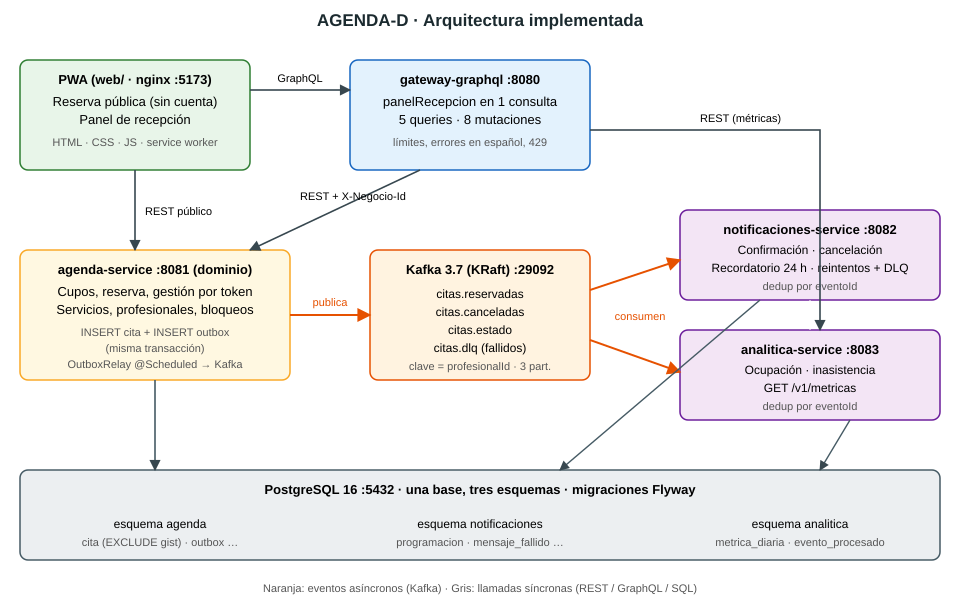
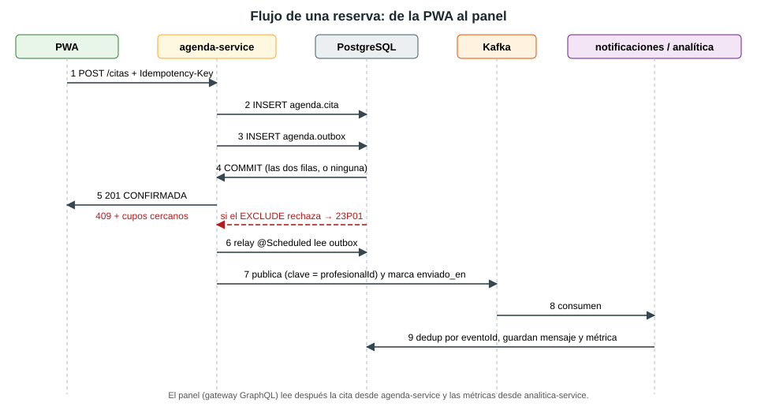

# Arquitectura · AGENDA-D

Descripción de la arquitectura **efectivamente implementada** y verificada.
Cada afirmación de este documento se puede comprobar en el código o en
[`docs/PRUEBAS.md`](PRUEBAS.md).

## 1. Vista general

Tres servicios de negocio, un gateway GraphQL y una PWA. Los servicios se
hablan de dos maneras:

- **Síncrona (REST, GraphQL, SQL):** lo que el usuario necesita para continuar.
  Consultar cupos, reservar, ver el panel.
- **Asíncrona (Kafka):** lo que ocurre *después* de reservar. Avisar al cliente,
  programar el recordatorio de 24 h, contar ocupación e inasistencia.

Si el usuario no necesita el resultado para continuar, no va en la petición:
va en un evento.

## 2. Responsabilidades

| Componente | Puerto | Responsabilidad | Habla con | Persistencia |
|---|---|---|---|---|
| **web** (PWA) | 5173 | Reserva pública sin cuenta y panel de recepción. HTML/CSS/JS sin framework, instalable (`manifest.json` + service worker). La reserva exige conexión. | `agenda-service` (REST público) y `gateway-graphql` (GraphQL) | `localStorage` solo para el modo de demostración |
| **agenda-service** | 8081 | Dominio: negocios, servicios, profesionales, horarios, bloqueos, disponibilidad, reserva, gestión por token, outbox. Único dueño del esquema `agenda`. Productor de eventos. | PostgreSQL, Kafka | Esquema `agenda` |
| **notificaciones-service** | 8082 | Consume los eventos de citas; confirma, cancela y programa el recordatorio de 24 h; reintenta y envía a la DLQ. | Kafka, PostgreSQL | Esquema `notificaciones` |
| **analitica-service** | 8083 | Consume los eventos y mantiene la ocupación y la inasistencia por día. Expone `GET /v1/metricas`. | Kafka, PostgreSQL | Esquema `analitica` |
| **gateway-graphql** | 8080 | Compone la pantalla del panel en una sola consulta (`panelRecepcion`), 5 queries y 8 mutaciones. Traduce errores a GraphQL, limita profundidad, complejidad y peticiones. | `agenda-service`, `analitica-service` (REST) | Ninguna |
| **PostgreSQL 16** | 5432 | Una base, tres esquemas. Migraciones con Flyway. Aquí vive la restricción `EXCLUDE`. | — | Volumen `pgdata` |
| **Kafka 3.7 (KRaft)** | 29092 (host) / 9092 (red) | Bus de eventos: `citas.reservadas`, `citas.canceladas`, `citas.estado`, `citas.dlq`. | — | Retención 7 días |
| Kafka UI | 8090 | Consola para ver tópicos y mensajes (desarrollo). | Kafka | — |
| pgAdmin | 5050 | Ver los datos guardados (desarrollo, sin login). | PostgreSQL | — |

Cada servicio Java tiene su propio `pom.xml` y su `Dockerfile`; no hay proyecto
padre. Los esquemas no se cruzan: ningún servicio lee tablas de otro. Lo que
necesita saber de otro servicio lo recibe por evento o por su API.

## 3. Comunicación

### 3.1 Flujo de una reserva

### 3.2 Contratos

| Canal | Contrato | Dónde |
|---|---|---|
| REST de `agenda-service` | OpenAPI 3 | [`docs/openapi/agenda-service.yaml`](openapi/agenda-service.yaml) |
| REST de `analitica-service`, `notificaciones-service`, `gateway-graphql` | OpenAPI 3 | [`docs/openapi/`](openapi/) |
| GraphQL | Esquema SDL | [`docs/graphql/schema.graphqls`](graphql/schema.graphqls) |
| Eventos Kafka | JSON con `version`, `eventoId`, `negocioId`, `correlationId` | [`docs/eventos/CONTRATO-EVENTOS.md`](eventos/CONTRATO-EVENTOS.md) |
| API en vivo | Swagger UI | <http://localhost:8081/swagger-ui.html> |

## 4. Decisiones de diseño

| Decisión | Por qué | Cómo se verifica |
|---|---|---|
| **El solapamiento lo impide la base de datos** (`EXCLUDE USING gist` sobre `tstzrange(inicio, fin, '[)')`) | Entre un `SELECT` y un `INSERT` cabe otra petición; `UNIQUE(profesional_id, inicio)` no detecta una cita de 60 min a las 10:00 contra otra a las 10:30. | Prueba de 100 hilos: 1 éxito y 99 conflictos |
| **Outbox**: la cita y el evento se escriben en la misma transacción | Publicar directo en Kafka puede dejar una cita sin evento si algo falla entre las dos operaciones. | `OutboxRelayTest`; outbox con 0 pendientes tras la prueba |
| **Todo instante en UTC** (`timestamptz`) | Evita errores de zona; los horarios se guardan en hora local y se resuelven con `negocio.zona_horaria`. | Pruebas de disponibilidad |
| **Idempotencia**: `Idempotency-Key` en `POST /citas`; deduplicación por `eventoId` en los consumidores | Kafka entrega al menos una vez y los clientes reintentan. | Newman: reenviar la misma clave devuelve la cita original |
| **Clave de partición = `profesionalId`** | La cancelación nunca se procesa antes que la reserva que la origina. | Contrato de eventos |
| **Reintentos con espera creciente y DLQ** (1 s, 4 s, 16 s) | Un mensaje malo no bloquea el resto. | `CitasEventoConsumidorTest` |
| **Sin autenticación** | Fuera de alcance por acuerdo con el docente. El contexto de negocio llega por `slug` o por la cabecera `X-Negocio-Id`. | Ver limitaciones |
| **Mensajes de error en español**, formato `{codigo, mensaje}` | Nunca un stacktrace ni un código técnico al usuario. | Newman y flujo de evidencia |

## 5. Modelo de datos

14 tablas en tres esquemas, creadas por las migraciones (`db/V1`, `V2`, `V3`) más
la tabla de control `flyway_schema_history` de Flyway:

| Esquema | Tablas |
|---|---|
| `agenda` | `negocio`, `servicio`, `profesional`, `servicio_profesional`, `horario_atencion`, `bloqueo`, `cita`, `token_gestion`, `outbox` |
| `notificaciones` | `programacion`, `evento_procesado`, `mensaje_fallido` |
| `analitica` | `metrica_diaria`, `evento_procesado` |

La migración `V1` incluye **datos ficticios** de prueba: el negocio
«Barbería El Corte» (`slug` `barberia-el-corte`), dos servicios (Corte de
cabello 60 min y Barba 30 min), dos profesionales (Laura y Andrés) y su horario de lunes a sábado de 08:00 a 18:00.
Nunca se usa `ddl-auto: update`.

## 6. Arquitectura aprobada frente a la implementada

| Elemento de la arquitectura aprobada | Estado |
|---|---|
| Java 21 + Spring Boot 3.3 (3 servicios de negocio) | Implementado |
| PostgreSQL 16 con restricción `EXCLUDE` | Implementado |
| Kafka 3.7 en KRaft, tópicos y DLQ | Implementado |
| Patrón outbox y relay | Implementado |
| Gateway con Spring for GraphQL y `panelRecepcion` | Implementado |
| PWA sin framework, instalable | Implementado |
| Docker Compose con perfiles `infra`, `core` y `full` | Implementado |
| Recordatorio 24 h con recuperación tras reinicio | Implementado y probado con pruebas automáticas; el envío real al cliente **no** (ver abajo) |
| Envío por SMS, WhatsApp o correo | **Pendiente.** Hoy el aviso se registra en la base de datos (adaptador `RegistroCanal`), sin proveedor externo. |
| Autenticación y roles | **Fuera de alcance** acordado con el docente |
| Backend público compartido (servidor) | **Pendiente.** `docker-compose.prod.yml` está listo pero desactivado; la PWA publicada en GitHub Pages reserva contra un `agenda-service` local. |
| Imagen de `analitica-service` en GHCR | **Pendiente** (es posterior al release `v1.0.2`) |

## 7. Dependencias externas

| Dependencia | Para qué | ¿Obligatoria para ejecutar? |
|---|---|---|
| Docker Desktop o Docker Engine con Compose v2 | Levantar todo | Sí |
| Internet en la primera ejecución | Descargar imágenes (Postgres, Kafka, nginx, Maven/JDK al construir) | Sí, solo la primera vez |
| `unpkg.com` | GraphiQL (`/graphiql`) carga sus scripts desde ahí | No; sin él `/graphql` sigue funcionando |
| GitHub (Pages, GHCR, Actions) | Publicación de la PWA, imágenes y CI | No para ejecutar localmente |
| Proveedor de SMS, WhatsApp o correo | Envío real de avisos | No; **no existe** en esta versión |
