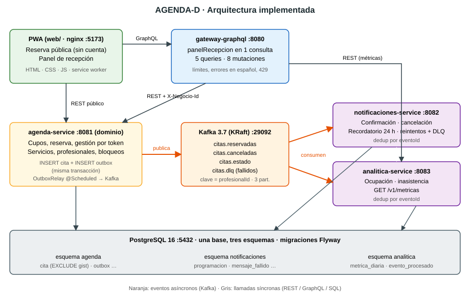
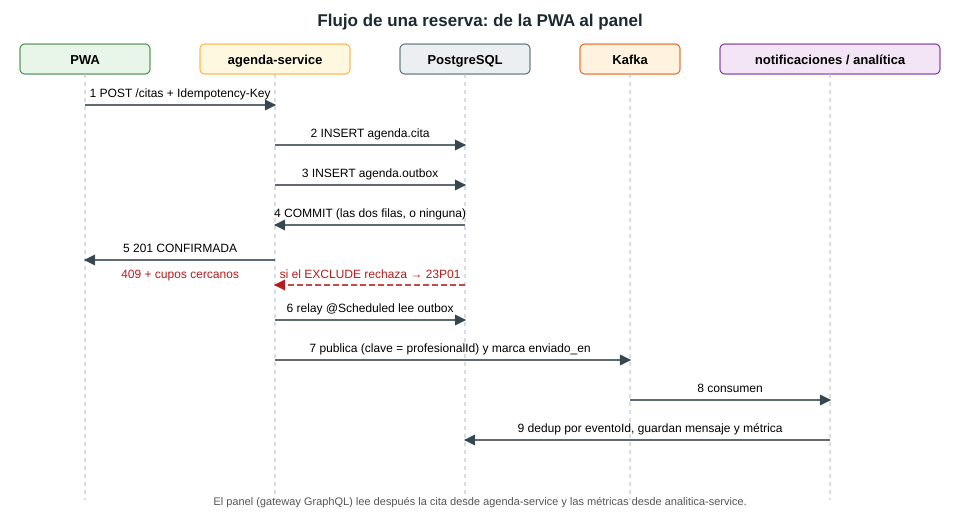
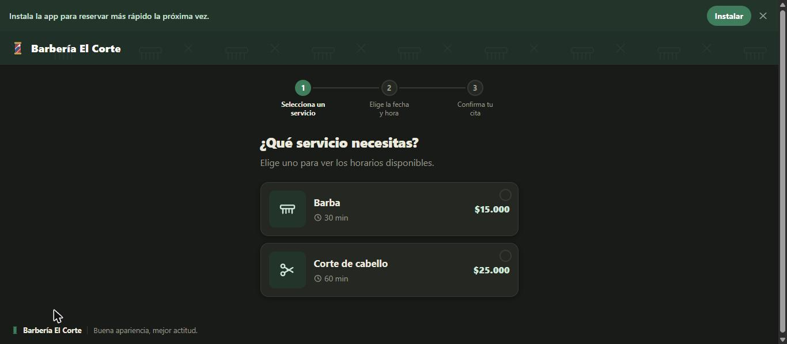
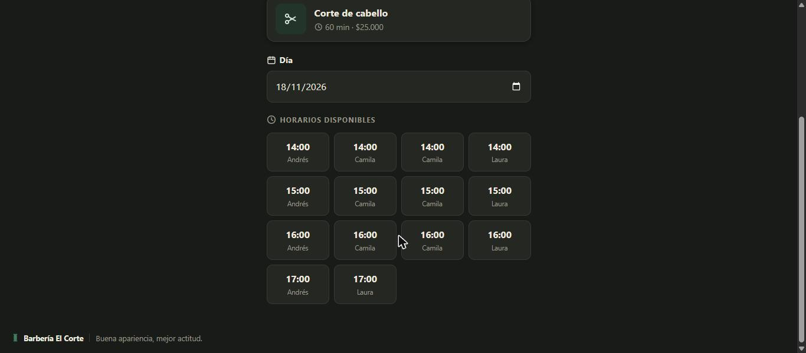
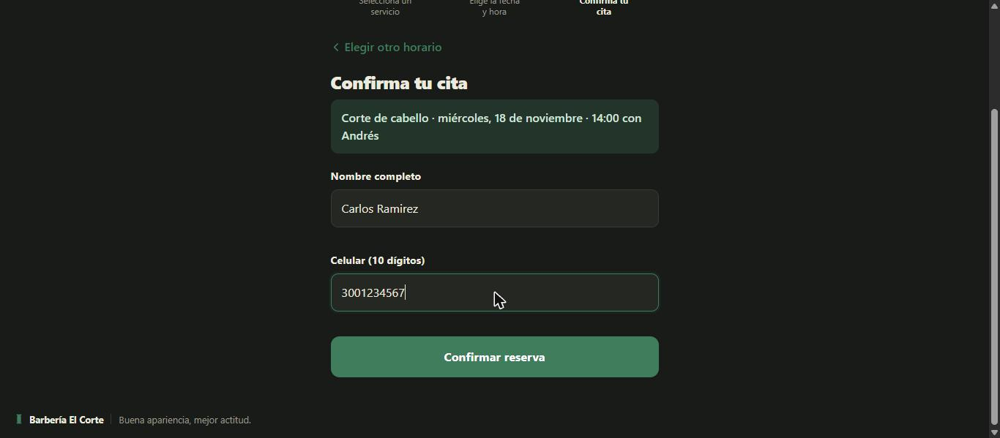
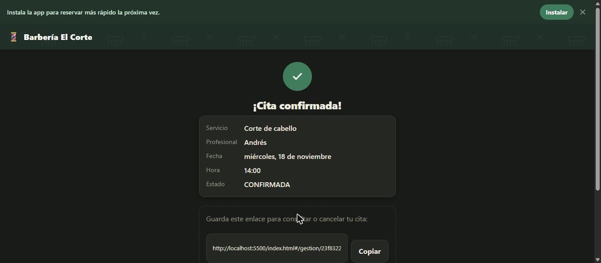
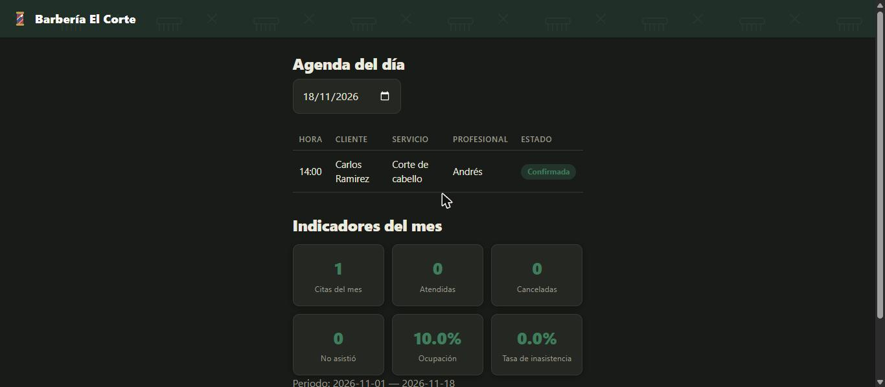
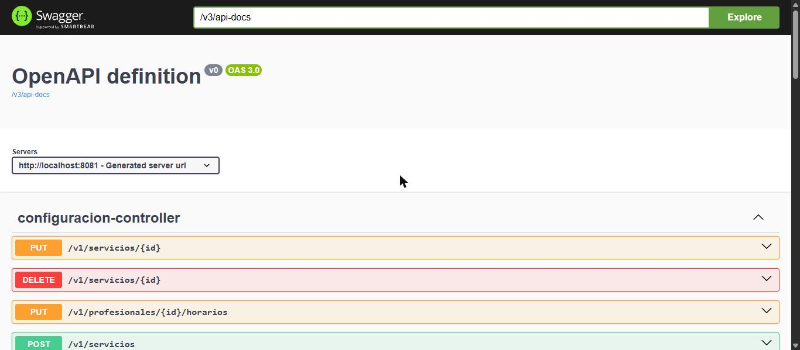
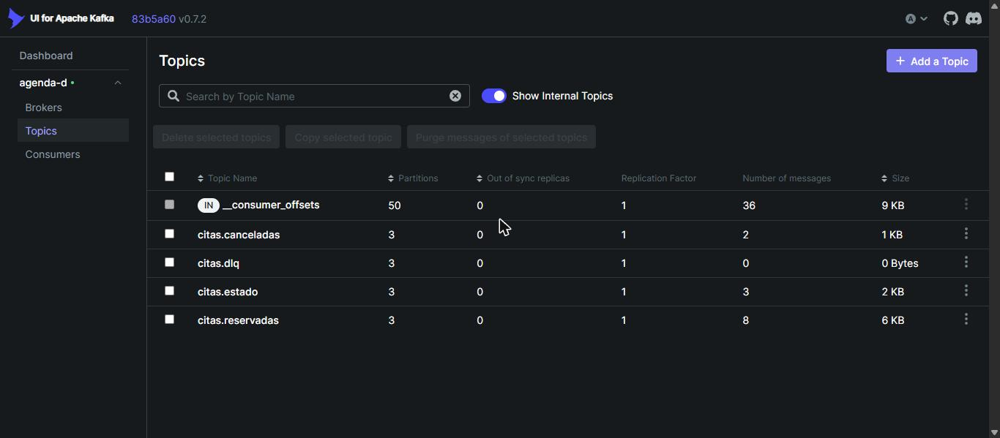
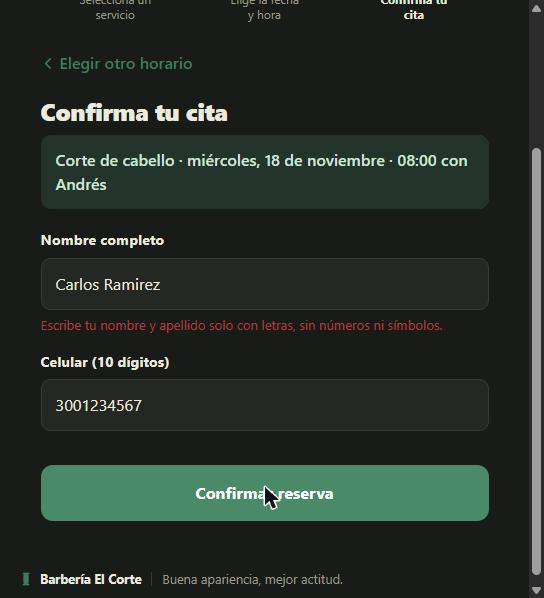

# Informe final del proyecto de aula · AGENDA-D

Plataforma distribuida de agendamiento de citas para negocios de servicios.

| | |
|---|---|
| **Nombre del proyecto** | AGENDA-D |
| **Asignatura y grupo** | Programación Avanzada · SOF-G2-NOC · Equipo 2 |
| **Integrantes** | Brayan Trujillo Ramón · Andrés Bonilla · Johan Camacho · Luis Emerson Moncada Carvajal |
| **Repositorio** | <https://github.com/brayantrujillodev/agenda-d> |
| **Versión entregada** | Etiqueta `entrega-final-2026-11-19` (mismo commit que el ZIP de entrega) |
| **Periodo** | Primer commit: 2026-08-27 · cierre de este informe: 2026-11-18 |
| **Docente** | Los datos y validaciones institucionales los completa el docente |

> Nombres completos de Andrés Bonilla y Johan Camacho: **pendientes de
> completar por cada integrante** (el repositorio solo registra sus nombres de
> usuario y un nombre corto).

Si una información ya está en un anexo del repositorio, este informe indica su
ubicación y no la duplica.

## Resumen

AGENDA-D es una plataforma distribuida para negocios de servicios (barberías,
consultorios, talleres, veterinarias). El negocio publica un enlace; el cliente
ve los cupos libres, reserva sin crear cuenta y recibe un aviso de confirmación
y un recordatorio 24 horas antes; el negocio ve su agenda del día y sus
indicadores de ocupación e inasistencia. La solución está formada por tres
servicios de negocio en Java 21 y Spring Boot 3.3 (`agenda-service`,
`notificaciones-service`, `analitica-service`), un gateway GraphQL, una PWA sin
framework, PostgreSQL 16 y Kafka 3.7, todo ejecutable con Docker Compose. La
decisión central es que **el solapamiento de citas lo impide la base de datos**
(restricción `EXCLUDE` sobre rangos de tiempo) y no el código, y que **el
evento de cada cita se guarda en la misma transacción** (patrón outbox) para que
avisar al cliente nunca ponga en riesgo la reserva. En la verificación final se
obtuvieron 116 de 116 pruebas automatizadas, 31 de 31 verificaciones de
extremo a extremo y 51 peticiones con 77 aserciones sin fallos en Postman, y la
prueba de 100 hilos reservando el mismo cupo dio 1 éxito y 99 conflictos. El
envío real de avisos (SMS, WhatsApp, correo), la autenticación y un servidor
público quedan pendientes o fuera de alcance, como se detalla en las
secciones 7 y 10.

## Abstract

AGENDA-D is a distributed appointment-scheduling platform for service
businesses (barbershops, clinics, workshops, veterinary offices). A business
publishes a link; customers see free slots, book without creating an account and
receive a confirmation and a reminder 24 hours before; the business sees its
daily agenda and occupancy and no-show indicators. The solution consists of
three Java 21 / Spring Boot 3.3 business services, a GraphQL gateway, a
framework-free PWA, PostgreSQL 16 and Kafka 3.7, all runnable with Docker
Compose. Its core design decisions are that **overlapping appointments are
prevented by the database** (an `EXCLUDE` constraint over time ranges) rather
than by application code, and that **each appointment's event is written in the
same transaction** (transactional outbox) so that notifying the customer can
never endanger the booking. The final verification produced 116 of 116 automated
tests, 31 of 31 end-to-end checks and 51 requests with 77 assertions with no
failures in Postman; the test with 100 threads booking the same slot yielded 1
success and 99 conflicts. Real message delivery (SMS, WhatsApp, e-mail),
authentication and a public server remain pending or out of scope.

**Keywords:** appointment scheduling, microservices, PostgreSQL exclusion
constraint, transactional outbox, Apache Kafka, GraphQL, PWA.

## 1. Problema

Los negocios pequeños de servicios agendan por mensajes y llamadas. Ese
proceso se equivoca de dos maneras: dos personas reciben el mismo horario, y el
cliente se olvida de la cita. Técnicamente el problema tiene dos partes:

1. **Concurrencia.** Dos solicitudes pueden pedir el mismo cupo al mismo tiempo.
   Validar con una consulta antes de guardar deja una ventana en la que cabe
   otra solicitud, y una restricción de unicidad sobre el instante de inicio no
   detecta que una cita de 60 minutos a las 10:00 y otra a las 10:30 se pisan.
2. **Acoplamiento.** Si avisar al cliente ocurre dentro de la reserva, un
   servicio de mensajería lento o caído impide agendar.

## 2. Justificación

Reservar es lo único que el cliente espera en pantalla; confirmar, recordar y
medir ocurren después y pueden fallar o demorarse sin afectarlo. Separar lo
síncrono (reservar, consultar) de lo asíncrono (avisar, medir) con eventos
permite que cada parte falle y se recupere por su cuenta. Además, el proyecto
es el escenario de aula para aplicar contenidos de la asignatura:
microservicios, persistencia relacional avanzada, mensajería, GraphQL,
contenedores y pruebas con infraestructura real. La arquitectura fue aprobada
por el docente según consta en el README; en el repositorio no hay un
documento de aprobación, y esa validación corresponde al docente.

## 3. Objetivos

**Objetivo general.** Construir una plataforma distribuida de agendamiento de
citas en la que ninguna cita pueda solaparse con otra del mismo profesional y
en la que los avisos y la analítica funcionen de forma asíncrona sin poner en
riesgo la reserva.

**Objetivos específicos.**

1. **Integridad de la reserva.** Garantizar, en `agenda-service` y PostgreSQL,
   que no existan citas solapadas aun bajo concurrencia, que reintentar una
   reserva no cree otra y que cada negocio solo acceda a sus datos.
2. **Desacople y tolerancia a fallos.** Comunicar la reserva con
   `notificaciones-service` y `analitica-service` mediante outbox y Kafka, con
   deduplicación, reintentos, cola de mensajes fallidos y recordatorio de 24 h.
3. **Interfaces y verificación.** Ofrecer una PWA de reserva sin cuenta y un
   panel de recepción servido por un gateway GraphQL, y demostrar el
   funcionamiento con pruebas automatizadas y evidencias reproducibles.

## 4. Fundamentos

| Concepto | Para qué se usó | Fuente |
|---|---|---|
| Restricción de exclusión de PostgreSQL (`EXCLUDE USING gist`) con `tstzrange` | Impedir citas solapadas del mismo profesional; el motor arbitra la concurrencia | [1] |
| Transactional outbox | Guardar la cita y su evento en la misma transacción y publicar después | [2] |
| Entrega «al menos una vez» de Kafka, claves de partición, consumidores idempotentes | Orden por profesional y deduplicación por `eventoId` | [3] |
| Idempotencia en HTTP (`Idempotency-Key`) | Reenviar una reserva devuelve la original | [4] |
| GraphQL y patrón gateway | Componer la pantalla del panel en una consulta | [5], [6] |
| Migraciones versionadas | Esquema reproducible, sin `ddl-auto: update` | [7] |
| Pruebas con contenedores reales | Concurrencia y separación entre negocios contra Postgres real | [8] |
| Aplicaciones web progresivas | Instalable, con service worker; la reserva exige conexión | [9] |
| Almacenar instantes en UTC | Evitar errores de zona horaria; horarios locales resueltos con la zona del negocio | Decisión de diseño |

## 5. Metodología realmente aplicada

**Marco.** Desarrollo incremental en tres fases con un hito por fase, y una
regla de prioridad acordada con el docente según consta en el README: primero
el circuito completo y después la robustez.

| Fase | Contenido | Resultado |
|---|---|---|
| 1 · Cimientos | Contratos (OpenAPI, GraphQL, eventos), migración con el `EXCLUDE`, Compose con `/actuator/health`, reserva contra la base real | Cerrada |
| 2 · Flujo mínimo | REST → persistencia → outbox → Kafka → consumidor → GraphQL, más la PWA | Cerrada |
| 3 · Robustez | Reintentos y DLQ, idempotencia, prueba de concurrencia, recordatorio de 24 h, analítica, panel, separación entre negocios | Cerrada |

**Prácticas que sí se aplicaron** (comprobables en el repositorio):

- **Contratos primero:** `docs/openapi/`, `docs/graphql/` y `docs/eventos/`
  se acuerdan antes de programar.
- **Rama por tarea y PR:** 31 PR fusionados en GitHub hasta el cierre.
- **Pruebas contra infraestructura real:** Testcontainers con Postgres y
  Kafka, y el stack completo en Docker, sin simular lo que importa.
- **Integración continua:** GitHub Actions compila, prueba y valida el estilo
  de Markdown, YAML, shell y SQL en cada cambio.
- **Evidencia reproducible:** un script y una colección de Postman regeneran
  los resultados (`docs/MANUAL-TECNICO.md` §5).

**Uso de un asistente de IA.** En parte del desarrollo y en la documentación
final se usó el asistente Claude Code. 70 de los 97 commits del historial
llevan la línea `Co-Authored-By: Claude`, desde 2026-09-02 hasta 2026-11-18. Las
pruebas descritas en este informe se ejecutaron realmente; cada resultado tiene
su evidencia en `docs/evidencias/`.

**Lo que no se hizo como estaba previsto.** La reunión conjunta semanal de dos
horas figura en las reglas del equipo (README), pero el repositorio no
guarda registro de ella, por lo que no se afirma su cumplimiento. El gateway
GraphQL, asignado a Luis Moncada, fue completado en su versión final por otros
integrantes (ver sección 13).

## 6. Desarrollo de la solución

La arquitectura, las responsabilidades de cada componente, la comunicación y
las decisiones de diseño están en [`docs/ARQUITECTURA.md`](ARQUITECTURA.md).
Resumen:

| Componente | Puerto | Función |
|---|---|---|
| `agenda-service` | 8081 | Dominio, reserva, outbox. Única escritura sobre el esquema `agenda` |
| `notificaciones-service` | 8082 | Confirmación, cancelación y recordatorio; reintentos y DLQ |
| `analitica-service` | 8083 | Ocupación e inasistencia por día |
| `gateway-graphql` | 8080 | `panelRecepcion` en una consulta; 5 queries, 8 mutaciones |
| PWA (`web/`, nginx) | 5173 | Reserva pública y panel de recepción |
| PostgreSQL 16 / Kafka 3.7 | 5432 / 29092 | Datos (3 esquemas) y eventos (4 tópicos) |

Todo se levanta con `docker compose --profile full up -d --build`
([`MANUAL-TECNICO.md`](MANUAL-TECNICO.md)). Contratos: [`openapi/`](openapi/),
[`graphql/schema.graphqls`](graphql/schema.graphqls),
[`eventos/CONTRATO-EVENTOS.md`](eventos/CONTRATO-EVENTOS.md).

## 7. Resultados

Estado de cada objetivo y de cada elemento de la solución. **Implementado** =
funciona y tiene evidencia; **Parcial** = funciona con alcance reducido;
**Pendiente** = no existe.

| Objetivo | Elemento | Estado | Evidencia |
|---|---|---|---|
| OE1 | Sin solapes por restricción de la base de datos | Implementado | P-06, P-07 |
| OE1 | Idempotencia de la reserva (`Idempotency-Key`) | Implementado | P-04 |
| OE1 | Validación estricta de nombre, celular y cupo | Implementado | P-08, P-09, P-29 |
| OE1 | Separación entre negocios | Implementado | P-10 |
| OE2 | Outbox en la misma transacción y relay a Kafka | Implementado | P-13, P-14 |
| OE2 | Deduplicación por `eventoId` | Implementado | P-15 |
| OE2 | Reintentos con espera creciente y DLQ | Implementado; envío a `citas.dlq` repetido el 2026-11-19 con un mensaje malformado; sin prueba automática propia y sin medir los tiempos de espera | P-16 |
| OE2 | Recordatorio de 24 h | Parcial: se programa y se envía el vencido; reinicio real del contenedor no medido | P-18 |
| OE2 | Envío real por SMS, WhatsApp o correo | **Pendiente** (el aviso se guarda en la base de datos) | P-19 |
| OE2 | Analítica de ocupación e inasistencia | Implementado (ocupación con jornada configurable) | P-27 |
| OE3 | PWA de reserva sin cuenta | Implementado | P-28 |
| OE3 | PWA instalable | Parcial: aviso de instalación observado; sin auditoría Lighthouse | P-30 |
| OE3 | Panel de recepción y gateway GraphQL (5 queries, 8 mutaciones) | Implementado | P-20 a P-26 |
| OE3 | Pruebas y evidencias reproducibles | Implementado | `PRUEBAS.md` |
| General | Autenticación y roles | Fuera de alcance (acordado con el docente) | — |
| General | Servidor público compartido | **Pendiente** (`docker-compose.prod.yml` listo, desactivado) | — |
| General | Prueba de carga sostenida | **Pendiente** | P-34 |

## 8. Pruebas y evidencias

El detalle completo —37 casos con resultado esperado, obtenido, estado, tipo
(medido, simulado o pendiente) y evidencia— está en
[`docs/PRUEBAS.md`](PRUEBAS.md). Resumen de lo **medido**:

| Prueba | Resultado | Evidencia |
|---|---|---|
| Pruebas automatizadas (`mvn verify`, Testcontainers) | 116 de 116 (70 + 7 + 9 + 30) | [`pruebas-maven.txt`](evidencias/pruebas-maven.txt) |
| Prueba de concurrencia: 100 hilos, un mismo cupo | 1 éxito, 99 conflictos | `ReservaConcurrenciaTest` |
| Flujo de extremo a extremo | 31 de 31 | [`P3-ENTREGA-1.md`](evidencias/P3-ENTREGA-1.md) |
| Postman con Newman | 51 peticiones, 77 aserciones, 0 fallos | [`newman-coleccion.txt`](evidencias/newman-coleccion.txt) |
| Arranque limpio | 8 contenedores arriba, 4 servicios `healthy` | [`estado-contenedores-y-bd.txt`](evidencias/estado-contenedores-y-bd.txt) |
| Integración continua en `main` | `build`, `lint` y `pages` en verde | Pestaña *Actions* de GitHub |

**Simulado:** el aviso al cliente se registra en la base de datos
(`RegistroCanal`), no llega a un teléfono ni a un correo. El modo
demostración de la PWA con datos de ejemplo (`web/mock.js`) existe pero no se
usó en esta entrega.

### Capturas (tomadas el 2026-11-18 sobre el sistema en ejecución)

**1 · El cliente elige el servicio.** La PWA lee el catálogo real.

**2 · Cupos libres del día.** Solo horas futuras; cada botón es un profesional con una franja libre.

**3 · Datos del cliente.** Sin cuenta ni contraseña.

**4 · Cita confirmada.** Estado `CONFIRMADA` y enlace para consultar o cancelar.

**5 · Panel de recepción.** La cita recién reservada aparece en la agenda y en
los indicadores: reserva, outbox, Kafka, analítica y GraphQL de extremo a extremo.

**6 · Swagger de `agenda-service`.**

**7 · Consola de Kafka.** Tópicos de negocio y `citas.dlq` sin mensajes.

**8 · Defecto detectado antes de corregirlo.** El formulario rechazaba
«Carlos Ramirez» por una expresión regular mal escrita.

No hay captura de GraphiQL (su página carga scripts de `unpkg.com`, que
respondió 503 en la prueba) ni de pgAdmin (ventana demasiado angosta); la
evidencia equivalente está en texto, en [`P3-ENTREGA-1.md`](evidencias/P3-ENTREGA-1.md)
y en [`estado-contenedores-y-bd.txt`](evidencias/estado-contenedores-y-bd.txt).

### Defectos encontrados al probar contra infraestructura real

| Defecto | Cómo apareció | Corrección |
|---|---|---|
| Deadlock de Postgres en vez de la violación limpia del `EXCLUDE` bajo contención extrema | Prueba de 100 hilos | Reintento acotado con espera aleatoria |
| El cálculo de «cupos más cercanos» del `409` también podía hacer deadlock | Prueba de concurrencia en CI | Responder el `409` sin alternativas en ese caso |
| `programacion.canal` era `NOT NULL` y el recordatorio pendiente no tiene canal | La primera reserva con recordatorio cayó en `citas.dlq` | Migración `V3` |
| `registrarAsistencia` fallaba siempre: `HttpURLConnection` no admite `PATCH` | Flujo completo contra Docker | Cliente HTTP del JDK y prueba de regresión |
| El gateway inventaba datos si un servicio caía | Auditoría | Errores `SERVICIO_NO_DISPONIBLE`; sin datos ficticios |
| Testcontainers 1.20.4 incompatible con Docker 29 (pruebas con contenedores fallaban en local y en CI) | `mvn verify` | Subida a 1.21.4 |
| El formulario rechazaba cualquier nombre con la letra «s» | Reserva en el navegador | Expresión regular corregida (`\s`) |
| La disponibilidad ofrecía horas ya pasadas | Reserva en el navegador | `ValidadorCupo.esFuturo` y prueba nueva |

## 9. Conclusiones

1. **Delegar la exclusión en la base de datos cerró el problema de raíz.** Con
   100 hilos sobre un mismo cupo se obtuvo 1 reserva y 99 conflictos limpios,
   sin validaciones en Java que puedan quedar desfasadas.
2. **El outbox permite que reservar no dependa de Kafka.** La reserva responde
   igual con el bus caído; los eventos se publican al volver y los consumidores
   toleran entregas repetidas.
3. **Probar contra infraestructura real fue lo más rentable.** Los defectos más
   serios (deadlocks, una columna `NOT NULL`, un verbo HTTP no soportado, datos
   inventados) solo aparecieron con Postgres y Kafka reales.
4. **Los contratos primero evitaron integraciones a ciegas** entre cuatro
   personas trabajando en servicios distintos.
5. **Un fallo parcial se informa, no se disfraza:** si un servicio cae, el
   gateway devuelve un error en español en ese campo y deja pasar el resto.
6. **Se cumplieron los tres objetivos específicos** dentro del alcance acordado,
   con tres excepciones declaradas: envío real de avisos, servidor público y
   prueba de carga.

## 10. Limitaciones

- **Sin autenticación** (acordado con el docente): quien conozca un
  `X-Negocio-Id` actúa sobre ese negocio.
- **Sin envío real de mensajes**; el aviso se registra en la base de datos.
- **Sin servidor público:** la PWA publicada en GitHub Pages reserva contra un
  `agenda-service` local.
- **Ocupación aproximada:** usa una jornada configurable, no el horario real.
- **`analitica-service` sin imagen propia** en GHCR (posterior al release `v1.0.2`).
- **GraphiQL depende de un CDN externo** (`unpkg.com`).
- **Límite del gateway:** 120 peticiones por minuto por IP; correr seguidos el
  script de evidencia y Newman exige esperar un minuto.
- **Sin prueba de carga sostenida** ni auditoría de accesibilidad o de
  instalabilidad (Lighthouse).

## 11. Referencias

[1] The PostgreSQL Global Development Group. *PostgreSQL 16 Documentation:
Exclusion Constraints.* <https://www.postgresql.org/docs/16/ddl-constraints.html#DDL-CONSTRAINTS-EXCLUSION>

[2] Richardson, C. *Pattern: Transactional outbox.* microservices.io.
<https://microservices.io/patterns/data/transactional-outbox.html>; y
Richardson, C. (2018). *Microservices Patterns.* Manning.

[3] Apache Software Foundation. *Apache Kafka Documentation.*
<https://kafka.apache.org/documentation/>

[4] IETF HTTPAPI Working Group. *The Idempotency-Key HTTP Header Field*
(borrador). <https://datatracker.ietf.org/doc/draft-ietf-httpapi-idempotency-key-header/>

[5] GraphQL Foundation. *GraphQL Specification.* <https://spec.graphql.org/>

[6] VMware / Spring. *Spring for GraphQL Reference.*
<https://docs.spring.io/spring-graphql/reference/>

[7] Redgate. *Flyway Documentation.* <https://documentation.red-gate.com/flyway>

[8] Testcontainers. *Testcontainers for Java.* <https://java.testcontainers.org/>

[9] Mozilla. *Progressive web apps.* MDN Web Docs.
<https://developer.mozilla.org/docs/Web/Progressive_web_apps>

## 12. Recursos y presupuesto

Se distingue lo **real** (se gastó o se usó y consta) de lo **estimado**.

| Concepto | Real | Estimado |
|---|---|---|
| Infraestructura (servidores, licencias, dominios) | **\$0.** Todo corrió en los equipos del equipo con Docker; la publicación usó los niveles gratuitos de GitHub (Pages, GHCR, Actions) | — |
| Software | Código abierto: Java, Spring, PostgreSQL, Kafka, nginx, Docker. El asistente de IA Claude Code se usó como herramienta; el repositorio no registra su costo | — |
| Horas de trabajo | **No se registraron.** | 20 h por semana entre los cuatro durante 15 semanas = **300 h** (capacidad planeada, según el README) |
| Valoración en dinero del esfuerzo | No calculada | `300 h × tarifa por hora`. La tarifa no consta en el repositorio; la define el equipo o el docente |
| Despliegue en servidor | No realizado | Su costo mensual dependería del proveedor; `docker-compose.prod.yml` queda preparado |

## 13. Aporte individual

Evidencia objetiva tomada del historial de GitHub al 2026-11-18. La columna
«Aporte declarado» la completa cada integrante; este informe no la inventa.

| Integrante | Responsabilidad asignada | Commits en el historial | PR propios fusionados | Aporte declarado por el integrante |
|---|---|---|---|---|
| Brayan Trujillo Ramón | `agenda-service`: dominio, `EXCLUDE`, outbox | 62 (usuarios `trujilloramonbrayan-create` y «Brayan Trujillo Ramón») | 23 | *(por completar)* |
| Andrés Bonilla | PWA pública de reserva | 14 | 4 (más 1 abierto) | *(por completar)* |
| Johan Camacho | `notificaciones-service` | 3 (usuario `jhoancamachoar-commits`, por confirmar) | 1 (usuario `master2503`; 1 más cerrado sin fusionar) | *(por completar)* |
| Luis Emerson Moncada Carvajal | `gateway-graphql` | 1 | 1 | *(por completar)* |

Observaciones: según el historial, la versión final del gateway GraphQL, de
`analitica-service`, de la prueba de concurrencia y del panel de recepción se
registró en gran parte con la cuenta de Brayan Trujillo, con apoyo del asistente
de IA. Un integrante puede tener más de un usuario de Git, y la asignación de
los usuarios `jhoancamachoar-commits` y `master2503` a Johan Camacho se hizo por
el nombre del usuario: **cada integrante debe confirmar sus datos**. Los
conteos son orientativos.

## Anexos

| Anexo | Ubicación |
|---|---|
| A. Arquitectura, diagramas y responsabilidades | [`docs/ARQUITECTURA.md`](ARQUITECTURA.md), [`docs/diagramas/`](diagramas/) |
| B. Manual técnico: instalación, ejecución y uso | [`docs/MANUAL-TECNICO.md`](MANUAL-TECNICO.md) |
| C. Matriz de pruebas (37 casos) | [`docs/PRUEBAS.md`](PRUEBAS.md) |
| D. Evidencias: capturas, Maven, Newman, flujo, estado de la base | [`docs/evidencias/`](evidencias/) |
| E. Contrato REST (OpenAPI) | [`docs/openapi/`](openapi/) |
| F. Contrato GraphQL | [`docs/graphql/schema.graphqls`](graphql/schema.graphqls) |
| G. Contrato de eventos de Kafka | [`docs/eventos/CONTRATO-EVENTOS.md`](eventos/CONTRATO-EVENTOS.md) |
| H. Colección de Postman | [`docs/postman/AGENDA-D.postman_collection.json`](postman/AGENDA-D.postman_collection.json) |
| I. Migraciones y datos ficticios | [`db/`](../db/) |
| J. Variables de ejemplo | [`.env.example`](../.env.example) |
| K. Backlog y guion de sustentación | [`docs/TAREAS.md`](TAREAS.md), [`docs/GUION-SUSTENTACION.md`](GUION-SUSTENTACION.md) |
